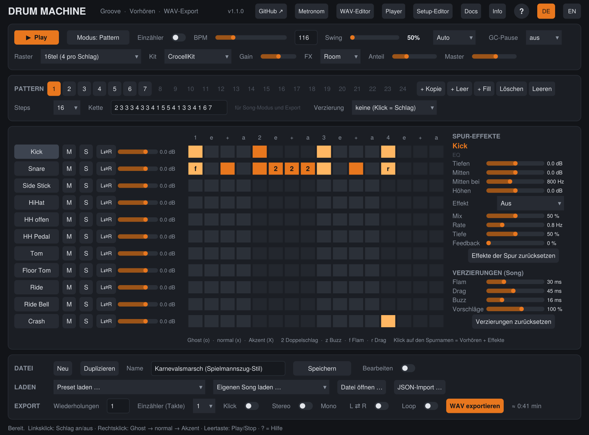
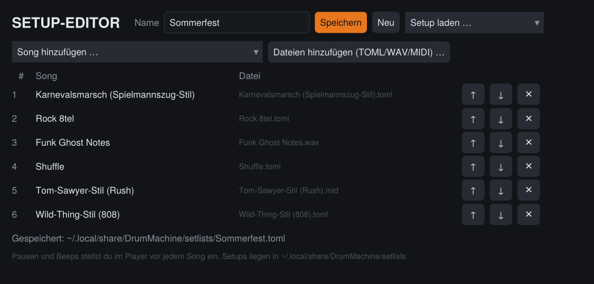

# DrumMachine.jl

[](https://github.com/Welthulk/DrumMachine.jl)
[](https://github.com/Welthulk/DrumMachine.jl/releases)
[](https://github.com/Welthulk/DrumMachine.jl/actions/workflows/CI.yml)
[](https://codecov.io/gh/Welthulk/DrumMachine.jl)
[](https://welthulk.github.io/DrumMachine.jl/dev/)
[](https://julialang.org)
[](LICENSE)
[](PLATFORMS.md)

[English](README.md) | Deutsch

Step-Sequencer in Julia zum Schlagzeug-Üben: Groove eintragen, vorhören, als WAV exportieren und mitspielen.



## Installation

Getestet unter Linux mit Julia 1.13 (Windows und macOS: siehe [PLATFORMS.md](PLATFORMS.md)). Gebraucht werden ein Grafiktreiber mit OpenGL (für GLMakie)
und eine Soundkarte. PortAudio bringt Julia selbst mit.

1. **Julia installieren**, am einfachsten mit [juliaup](https://github.com/JuliaLang/juliaup):

   ```bash
   curl -fsSL https://install.julialang.org | sh
   ```

2. **DrumMachine aus dem Julia-Paketregister installieren** (sobald die Registrierung durch ist):

   ```bash
   julia -t auto -e 'using Pkg; Pkg.add("DrumMachine"); using DrumMachine; DrumMachine.run()'
   ```

   Eigene Songs und WAV-Exporte liegen dann in `~/.local/share/DrumMachine/songs`.

   **Oder** Repo holen und Pakete installieren (dauert beim ersten Mal einige Minuten):

   ```bash
   git clone https://github.com/Welthulk/DrumMachine.jl.git
   cd DrumMachine.jl
   julia --project=. -e 'using Pkg; Pkg.instantiate()'
   ```

3. **Empfohlenes Systemprogramm:** `zenity` (GNOME) oder `kdialog` (KDE) für die Datei-Dialoge
   (`sudo apt install zenity`). Zum Entpacken der Kits (bsdtar) und für den AAC-Export (ffmpeg)
   bringt das Paket `LibArchive_jll` und `FFMPEG_jll` mit, dafür muss nichts installiert werden.

## Plattformen

Entwickelt und getestet nur unter Linux, Windows und macOS sind nicht getestet. Benötigte
Julia-Pakete und Programme sowie die bekannten Lücken für eine Portierung stehen in
[PLATFORMS.md](PLATFORMS.md) (englisch). Wer portieren möchte, ist herzlich eingeladen; weitere
Möglichkeiten zu helfen (testen, Songs, Hardware) stehen in [SUPPORT.md](SUPPORT.md).

## Start

```bash
./start_drum.sh
# oder: julia -t auto --project=. run.jl
```

Wichtig: aus einem normalen Terminal starten. In Umgebungen ohne OpenGL (z. B. VS Code als
Flatpak) öffnet sich kein Fenster.

Schneller Start: Fehlt das Sysimage `build/drummachine.so` (vorkompiliertes GLMakie), fragt
`./start_drum.sh`, ob es jetzt gebaut werden soll (dauert einige Minuten). Danach meldet das
Skript bei jedem Start, ob es das Image gefunden hat, und fragt nach Paket-Updates von selbst
nach einem Neubau. Direkt bauen: `./start_drum.sh --build`; ohne Image starten:
`./start_drum.sh --no-image`; nur den Setup-Player (für die Bühne): `./start_drum.sh --player`;
alle Optionen: `./start_drum.sh --help`.

**Sprache:** Deutsch oder Englisch über *DE* / *EN* in der Kopfzeile. Voreingestellt ist die
Systemsprache, die Wahl wird in `~/.config/DrumMachine/settings.toml` gespeichert.

### Gegen Knackser und Aussetzer

- **GC-Pause** (Transportzeile): hält die Speicherbereinigung von Julia (Garbage Collection, GC)
  beim Abspielen für 2–20 min an. Sie läuft bei Stop, nach Ablauf der Zeit oder unter 1 GB freiem
  Speicher wieder.
- **Audio-Puffer:** Play/Stop reagieren mit dem Puffer, voreingestellt 0,08 s. Knackt es, in
  `~/.config/DrumMachine/settings.toml` z. B. `audio_latency = 0.15` eintragen.
- **Hohe Priorität:** `./start_drum.sh --prio` (kombinierbar, z. B. `--prio --player`) startet das
  Programm mit `nice -15` und den Audio-Thread mit Echtzeit-Priorität 70. Einen Wert muss man
  nirgends eintragen, das Skript nimmt, was das System erlaubt. Ein normaler Benutzer braucht dafür
  einmalig die Rechte; PipeWire stellt sie für die Gruppe `pipewire` bereit:
  `sudo groupadd -f pipewire && sudo usermod -aG pipewire $USER` (der erste Befehl legt die Gruppe
  nur an, falls sie fehlt), danach ab- und wieder anmelden (`ulimit -r` zeigt dann 95
  statt 0). Ohne die Rechte startet das Programm normal und sagt Bescheid. Ein Setuid- oder
  Sticky-Bit am Skript hilft nicht: Linux ignoriert Setuid bei Skripten, Root-Rechte sind nicht nötig.

## Funktionen

Alle Funktionen stehen in [FEATURES.md](FEATURES.md), die Änderungen je Version in
[CHANGELOG.md](CHANGELOG.md) (beide englisch). Die Bedienung erklärt der **?**-Button im Programm,
*Docs* zeigt die Dokumentation ([docs/](docs), englisch): Song-Format, WAV-Editor, Metronom,
Setup-Player. Dieselben Seiten gibt es online:
[welthulk.github.io/DrumMachine.jl](https://welthulk.github.io/DrumMachine.jl/dev/). Über 40 Grooves liegen unter *Preset laden*, ausgearbeitete Beispiel-Songs unter
`songs/` (*Eigenen Song laden*).




## Kits

Nur BlackPearl liegt im Repo. Die übrigen Kits stehen im Kit-Menü als „(laden, Größe)“ und
werden erst geladen und gebaut, wenn man sie dort wählt (im Hintergrund, Fortschritt in der
Statuszeile); ohne das wird nichts heruntergeladen. Liste der Kits mit Herkunft, Lizenzen und
Größen, der Gain pro Kit, der automatische Download (`auto_kits = true`) und Kits von Hand bauen:
[KITS.md](KITS.md) (englisch).

## Lizenz

Code: [MIT](LICENSE). Die Samples stehen unter den Lizenzen in [KITS.md](KITS.md).
