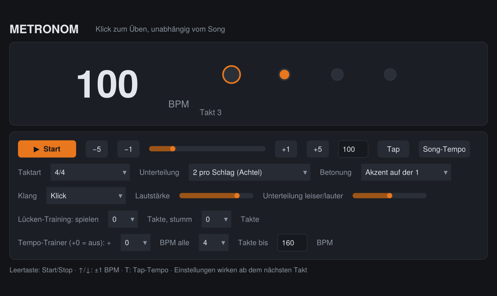
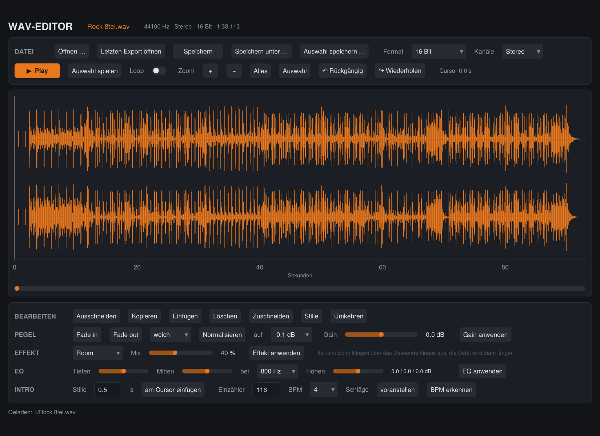
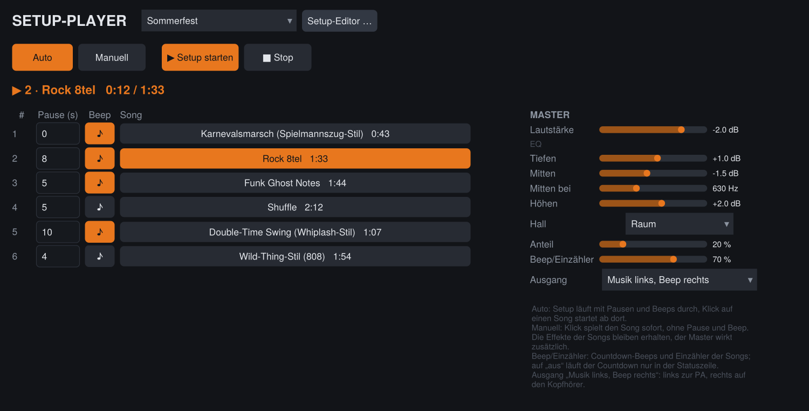

# DrumMachine.jl

[](https://github.com/Welthulk/DrumMachine.jl)
[](https://github.com/Welthulk/DrumMachine.jl/releases)
[](https://github.com/Welthulk/DrumMachine.jl/actions/workflows/CI.yml)
[](https://welthulk.github.io/DrumMachine.jl/dev/)
[](https://julialang.org)
[](LICENSE)
[](PLATFORMS.md)

[English](README.md) | Deutsch

Step-Sequencer in Julia zum Schlagzeug-Üben: Groove eintragen, vorhören, als WAV exportieren und mitspielen.


Die Oberfläche gibt es auf Deutsch und Englisch (Buttons *DE* / *EN* in der Kopfzeile; voreingestellt
ist die Systemsprache). Der **?**-Button öffnet eine kurze Hilfe, *Docs* die Dokumentation.

## Installation

Getestet unter Linux mit Julia 1.13 (Windows und macOS: siehe [PLATFORMS.md](PLATFORMS.md)). Gebraucht werden ein Grafiktreiber mit OpenGL (für GLMakie)
und eine Soundkarte. PortAudio bringt Julia selbst mit.

1. **Julia installieren**, am einfachsten mit [juliaup](https://github.com/JuliaLang/juliaup):

   ```bash
   curl -fsSL https://install.julialang.org | sh
   ```

2. **DrumMachine aus dem Julia-Paketregister installieren** (sobald die Registrierung durch ist):

   ```bash
   julia -t auto -e 'using Pkg; Pkg.add("DrumMachine"); using DrumMachine; DrumMachine.run()'
   ```

   Eigene Songs und WAV-Exporte liegen dann in `~/.local/share/DrumMachine/songs`.

   **Oder** Repo holen und Pakete installieren (dauert beim ersten Mal einige Minuten):

   ```bash
   git clone https://github.com/Welthulk/DrumMachine.jl.git
   cd DrumMachine.jl
   julia --project=. -e 'using Pkg; Pkg.instantiate()'
   ```

   Songs und Exporte landen dann im Ordner `songs/` des Repos (auch bei `Pkg.develop`).

3. **Empfohlenes Systemprogramm:** `zenity` (GNOME) oder `kdialog` (KDE) für die Datei-Dialoge
   (`sudo apt install zenity`). Zum Entpacken der Kits (bsdtar) und für den AAC-Export (ffmpeg)
   bringt das Paket `LibArchive_jll` und `FFMPEG_jll` mit, dafür muss nichts installiert werden.

## Plattformen

Entwickelt und getestet nur unter Linux, Windows und macOS sind nicht getestet. Benötigte
Julia-Pakete und Programme sowie die bekannten Lücken für eine Portierung stehen in
[PLATFORMS.md](PLATFORMS.md) (englisch). Wer portieren möchte, ist herzlich eingeladen; weitere
Möglichkeiten zu helfen (testen, Songs, Hardware) stehen in [SUPPORT.md](SUPPORT.md).

## Start

```bash
./start_drum.sh
# oder: julia -t auto --project=. run.jl
```

Wichtig: aus einem normalen Terminal starten. In Umgebungen ohne OpenGL (z. B. VS Code als
Flatpak) öffnet sich kein Fenster.

Schneller Start: Fehlt das Sysimage `build/drummachine.so` (vorkompiliertes GLMakie), fragt
`./start_drum.sh`, ob es jetzt gebaut werden soll (dauert einige Minuten). Danach meldet das
Skript bei jedem Start, ob es das Image gefunden hat, und fragt nach Paket-Updates oder einem
Julia-Update (z. B. per juliaup) von selbst nach einem Neubau. Direkt bauen:
`./start_drum.sh --build`; ohne Image starten: `./start_drum.sh --no-image`; nur den Setup-Player
(für die Bühne, immer mit `--prio`): `./start_drum.sh --player`; alle Optionen: `./start_drum.sh --help`.

55 Grooves (Rock, Pop, Country, Funk, Shuffle, Blues, Jazz, Latin, Reggae, Hip-Hop, R&B, Drum and
Bass, Jungle, Marsch, ungerade Takte) liegen unter *Preset laden*. Ausgearbeitete Beispiel-Songs
mit Form, Fills und Spur-Effekten liegen in `songs/` (*Eigenen Song laden*).

### Gegen Knackser und Aussetzer

- **GC-Pause** (Transportzeile): hält die Speicherbereinigung von Julia (Garbage Collection, GC)
  beim Abspielen für 2–20 min an. Sie läuft bei Stop, nach Ablauf der Zeit oder unter 1 GB freiem
  Speicher wieder.
- **Audio-Puffer:** Play/Stop reagieren mit dem Puffer, voreingestellt 0,08 s. Knackt es, in
  `~/.config/DrumMachine/settings.toml` z. B. `audio_latency = 0.15` eintragen.
- **Hohe Priorität:** `./start_drum.sh --prio` (in `--player` enthalten) startet das
  Programm mit `nice -15` und den Audio-Thread mit Echtzeit-Priorität 70. Einen Wert muss man
  nirgends eintragen, das Skript nimmt, was das System erlaubt. Ein normaler Benutzer braucht dafür
  einmalig die Rechte; PipeWire stellt sie für die Gruppe `pipewire` bereit:
  `sudo groupadd -f pipewire && sudo usermod -aG pipewire $USER` (der erste Befehl legt die Gruppe
  nur an, falls sie fehlt), danach ab- und wieder anmelden (`ulimit -r` zeigt dann 95
  statt 0). Ohne die Rechte startet das Programm normal und sagt Bescheid. Ein Setuid- oder
  Sticky-Bit am Skript hilft nicht: Linux ignoriert Setuid bei Skripten, Root-Rechte sind nicht nötig.

### Aufnahme vom E-Drum

Das Modul per USB anschließen, im Menü *MIDI* (Transportleiste) wählen und *● Aufnahme* drücken:
jeder Schlag landet im laufenden Pattern auf dem nächsten Step. Die Notentabelle ist für das
Roland TD-27 gemacht; unter Linux muss es im USB-Treibermodus GENERIC laufen. Einzelheiten,
Notentabelle und Einstellungen: [docs/midi.md](docs/midi.md) (englisch). Der Button *MIDI* in der
Export-Zeile schreibt den Song als MIDI-Datei, z. B. für eine DAW oder MuseScore. Der
Setup-Player spielt MIDI-Dateien über einen MIDI-Ausgang ab, z. B. zurück ans Modul
([docs/player.md](docs/player.md), englisch).

## Funktionen

Alle Funktionen stehen in [FEATURES.md](FEATURES.md), die Änderungen je Version in
[CHANGELOG.md](CHANGELOG.md) (beide englisch). Die Bedienung erklärt der **?**-Button im Programm,
*Docs* zeigt die Dokumentation ([docs/](docs), englisch): Song-Format, WAV-Editor, Metronom,
Setup-Player, MIDI-Aufnahme und -Export. Dieselben Seiten gibt es online:
[welthulk.github.io/DrumMachine.jl](https://welthulk.github.io/DrumMachine.jl/dev/).
*Info* zeigt Version, Autor, Datum der letzten Änderung und die Lizenzen der Kits.








## Kits

Nur BlackPearl liegt im Repo. Die übrigen Kits stehen im Kit-Menü als „(laden, Größe)“ und
werden erst geladen und gebaut, wenn man sie dort wählt (im Hintergrund, Fortschritt in der
Statuszeile); ohne das wird nichts heruntergeladen. Schlägt ein Download fehl, bleibt das Kit für
einen neuen Versuch im Menü. Liste der Kits mit Herkunft, Lizenzen und
Größen, der Gain pro Kit, der automatische Download (`auto_kits = true`) und Kits von Hand bauen:
[KITS.md](KITS.md) (englisch).

## Einstellungen

`~/.config/DrumMachine/settings.toml` speichert die in der Kopfzeile gewählte Sprache
(`language = "en"` oder `"de"`), `auto_kits` (siehe [KITS.md](KITS.md)), den Gain pro Kit
(`[kit_gain]`), `audio_latency` (siehe oben), die GC-Pause in Minuten (`gc_pause`), die MIDI-Aufnahme
(`midi_device`, `[midi_map]`, `midi_ghost`, `midi_accent`, `midi_offset_ms`, siehe
[docs/midi.md](docs/midi.md), englisch), beim Setup-Player das letzte Setup, den Modus, die
Master-Einstellungen und den MIDI-Ausgang (`[player]`), das Metronom (`[metronome]`) und die letzte
Sitzung (`[session]`).

## Lizenz

Code: [MIT](LICENSE). Die Samples stehen unter den Lizenzen in [KITS.md](KITS.md).
