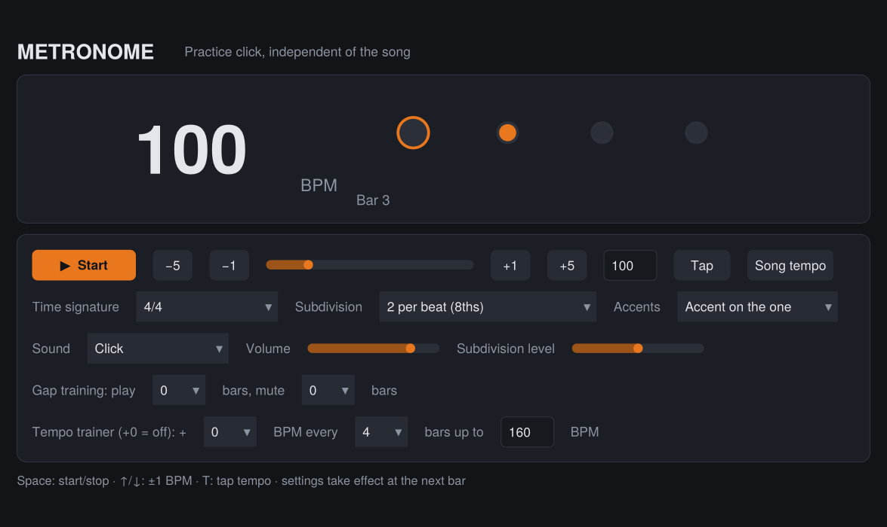
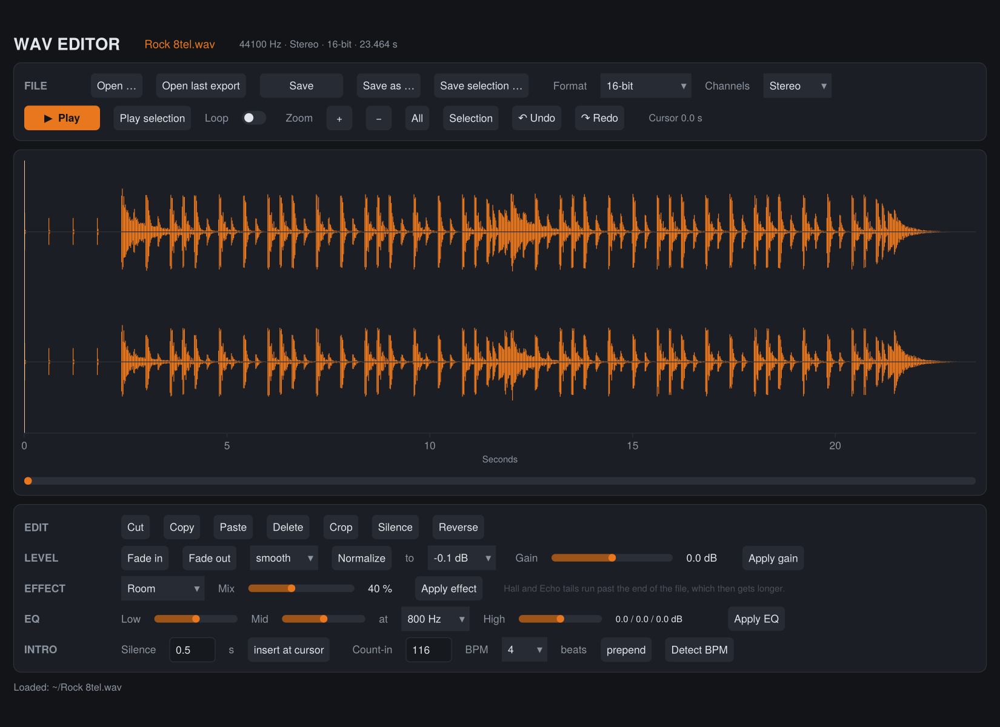
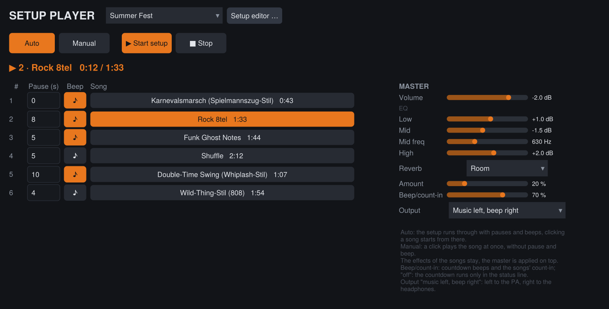
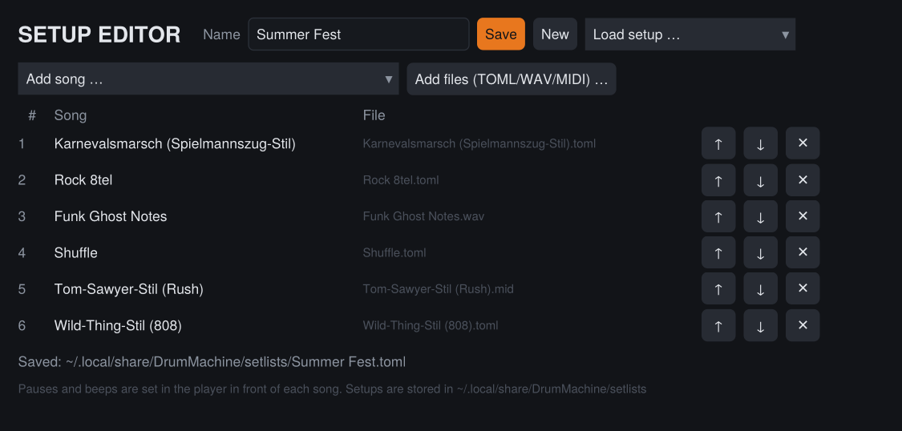

# DrumMachine.jl

[](https://github.com/Welthulk/DrumMachine.jl)
[](https://github.com/Welthulk/DrumMachine.jl/releases)
[](https://github.com/Welthulk/DrumMachine.jl/actions/workflows/CI.yml)
[](https://welthulk.github.io/DrumMachine.jl/dev/)
[](https://julialang.org)
[](LICENSE)
[](PLATFORMS.md)

English | [Deutsch](README.de.md)

Step sequencer in Julia for drum practice: enter a groove, listen to it, export it as WAV and play along.


The interface is available in English and German (buttons *EN* / *DE* in the header; the default
follows the system language). The **?** button opens a short help, *Docs* the documentation.

## Installation

Tested on Linux with Julia 1.13 (Windows and macOS: see [PLATFORMS.md](PLATFORMS.md)). You need a graphics driver with OpenGL (for GLMakie) and a
sound card. PortAudio is installed by Julia itself.

1. **Install Julia**, easiest with [juliaup](https://github.com/JuliaLang/juliaup):

   ```bash
   curl -fsSL https://install.julialang.org | sh
   ```

2. **Install DrumMachine** from the Julia package registry:

   ```bash
   julia -t auto -e 'using Pkg; Pkg.add("DrumMachine"); using DrumMachine; DrumMachine.run()'
   ```

   Your songs and WAV exports are then stored in `~/.local/share/DrumMachine/songs`.

   **Or** get the repository and install the packages (takes a few minutes the first time):

   ```bash
   git clone https://github.com/Welthulk/DrumMachine.jl.git
   cd DrumMachine.jl
   julia --project=. -e 'using Pkg; Pkg.instantiate()'
   ```

   Songs and exports then go to the `songs/` folder of the checkout (also with `Pkg.develop`).

3. **Recommended system tool:** `zenity` (GNOME) or `kdialog` (KDE) for the file dialogs
   (`sudo apt install zenity`). Unpacking the kits (bsdtar) and the AAC export (ffmpeg) use
   the Julia packages `LibArchive_jll` and `FFMPEG_jll`, nothing to install.

## Platforms

Developed and tested on Linux only; Windows and macOS are untested. Required Julia packages and
programs and the known gaps for a port are listed in [PLATFORMS.md](PLATFORMS.md). Ports are welcome,
see [SUPPORT.md](SUPPORT.md) for other ways to help (testing, songs, hardware).

## Start

```bash
./start_drum.sh
# or: julia -t auto --project=. run.jl
```

Start it from a regular terminal. Environments without OpenGL (e.g. VS Code as Flatpak)
cannot open the window.

Faster start: if the sysimage `build/drummachine.so` (precompiled GLMakie) is missing,
`./start_drum.sh` asks whether to build it now (takes a few minutes). After that the script reports
at every start whether it found the image, and offers a rebuild after package updates or a Julia
update (e.g. by juliaup). Build directly: `./start_drum.sh --build`; start without the image:
`./start_drum.sh --no-image`; only the setup player (for the stage, always with `--prio`):
`./start_drum.sh --player`; all options: `./start_drum.sh --help`.

55 grooves (rock, pop, country, funk, shuffle, blues, jazz, latin, reggae, hip-hop, R&B, drum and
bass, jungle, march, odd meters) are available under *Preset laden*. Worked-out example songs with
form, fills and track effects are in `songs/` (*Eigenen Song laden*).

### Against crackles and dropouts

- **GC pause** (transport row): holds Julia's garbage collection (GC) during playback for
  2–20 min. It resumes on stop, when the time is up or below 1 GB of free memory.
- **Audio buffer**: play/stop react with the buffer, 0.08 s by default. If it crackles, set e.g.
  `audio_latency = 0.15` in `~/.config/DrumMachine/settings.toml`.
- **High priority**: `./start_drum.sh --prio` (`--player` includes it) runs the
  program with `nice -15` and the audio thread with realtime priority 70. No value has to be
  entered, the script uses what the system allows. A normal user needs the rights once; PipeWire
  provides them for the group `pipewire`: `sudo groupadd -f pipewire && sudo usermod -aG pipewire $USER`
  (the first command only creates the group if it is missing), then log out and in
  again (`ulimit -r` then shows 95 instead of 0). Without the rights the program starts with
  normal priority and says so. A setuid or sticky bit on the script does not help: Linux ignores
  setuid on scripts, and root rights are not needed.

### Recording from an e-drum kit

Connect the drum module by USB, choose it in the *MIDI* menu (transport panel) and press
*● Aufnahme*: every hit goes into the playing pattern, on the nearest step. The note table is made
for the Roland TD-27; on Linux it has to be in USB driver mode GENERIC. Details, note table and
settings: [docs/midi.md](docs/midi.md). The *MIDI* button in the export row writes the song as a MIDI
file, e.g. for a DAW or MuseScore. The setup player plays MIDI files through a MIDI output, e.g.
back to the drum module ([docs/player.md](docs/player.md)).

## Features

All features are listed in [FEATURES.md](FEATURES.md), the changes per version in
[CHANGELOG.md](CHANGELOG.md). The **?** button in the program explains the controls, *Docs* shows
the documentation ([docs/](docs)): song format, WAV editor, metronome, setup player, MIDI recording and export. The same pages
are online: [welthulk.github.io/DrumMachine.jl](https://welthulk.github.io/DrumMachine.jl/dev/).
*Info* shows the version, author, date of the last change and the kit licenses.









## Kits

Only BlackPearl is in the repository. The other kits are listed in the kit menu as
"(download, size)" and are downloaded and built when chosen (in the background, progress in the
status line); nothing is downloaded without that. If a download fails, the kit stays in the menu for another try. List of
kits with sources, licenses and sizes, the gain per kit, the automatic download
(`auto_kits = true`) and building kits by hand: [KITS.md](KITS.md).

## Settings

`~/.config/DrumMachine/settings.toml` stores the language chosen in the header
(`language = "en"` or `"de"`), `auto_kits` (see [KITS.md](KITS.md)), the gain per kit
(`[kit_gain]`), `audio_latency` (see above), the GC pause in minutes (`gc_pause`), the MIDI recording
(`midi_device`, `[midi_map]`, `midi_ghost`, `midi_accent`, `midi_offset_ms`, see
[docs/midi.md](docs/midi.md)), the setup player's last setup, mode, master settings and MIDI output
(`[player]`), the metronome (`[metronome]`) and the last session (`[session]`).

## License

Code: [MIT](LICENSE). The samples are licensed as listed in [KITS.md](KITS.md).
