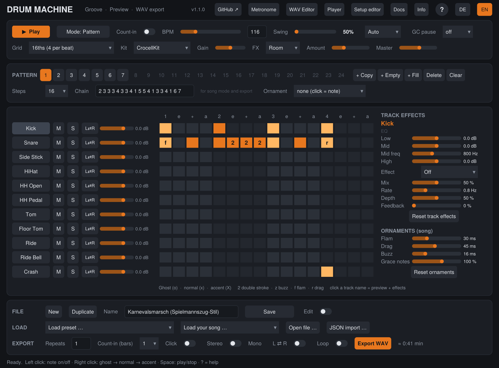

# DrumMachine.jl

Step-Sequencer in Julia zum Schlagzeug-Üben: Groove eintragen, vorhören, als WAV exportieren und mitspielen.



## Start

```bash
./start_drum.sh
# oder: julia -t auto --project=. run.jl
```

Schneller Start: einmalig `./start_drum.sh --build` ausführen (dauert einige Minuten). Das baut
`build/drummachine.so` mit vorkompiliertem GLMakie, danach nutzt `./start_drum.sh` das Image
automatisch. Nach Paket-Updates neu bauen, das Skript weist darauf hin.

Die Bedienung erklärt der **?**-Button im Programm. Über 40 Grooves (Rock, Funk, Shuffle, Blues, Jazz, Latin, ungerade Taktarten) liegen unter *Preset laden*.

## Kits

| Kit | Herkunft | Lizenz |
|---|---|---|
| BlackPearl | [AVL Drumkits](http://www.bandshed.net/avldrumkits/), im Repo | CC BY-SA 3.0 |
| CrocellKit | [DrumGizmo](https://drumgizmo.org/wiki/doku.php?id=kits%3Acrocellkit), Stereo-Mix von Henry Järvinen | CC BY 4.0 |
| VirtuosityDrums | [Versilian Studios / Karoryfer](https://github.com/sfzinstruments/virtuosity_drums) | CC0 |
| 808 / 909 (Synth) | synthetisiert | – |

CrocellKit und VirtuosityDrums sind zu groß fürs Repo und werden einmalig gebaut:

```bash
julia --project=. tools/build_crocell.jl       # lädt 561 MB
julia --project=. tools/build_virtuosity.jl    # lädt 1,2 GB
```

## Lizenz

Code: [MIT](LICENSE). Die Samples stehen unter den oben genannten Lizenzen.
