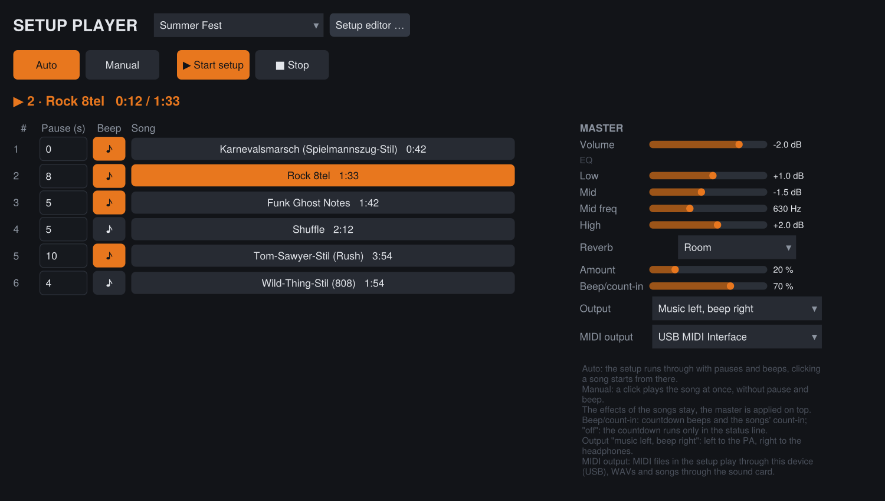
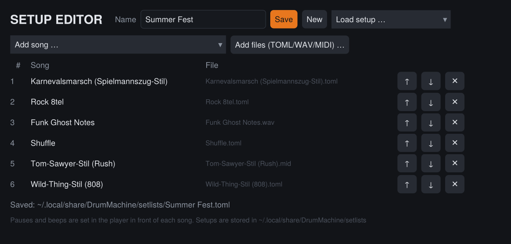

# Setup player

The setup player is for the stage: it plays finished songs one after another while you play
drums or keyboard live. A *setup* is an ordered list of songs (`.toml`), audio files (`.wav`) and
MIDI files (`.mid`). A WAV file goes out through the sound card, a MIDI file through the MIDI
output, e.g. to a drum module or synthesizer connected by USB.



## Starting

- On its own, without the main window: `./start_drum.sh --player`
  (or `julia -t auto --project=. run.jl --player`). `--player` always includes `--prio`: high
  priority and a realtime audio thread. This needs the group `pipewire` once (see the README);
  without the rights (`ulimit -r` is 0) the audio thread runs with normal priority and the
  script says so. When no
  song plays, the status line shows *Echtzeit-Priorität 70* (realtime priority) or
  *ohne Echtzeit-Priorität* (none). `julia … run.jl --player` without the script runs with normal
  priority.
- From the main window: button *Player* in the header. It then shares the sound card with the
  main window. The button *Setup-Editor* next to it opens the editor directly.

When a setup is loaded, the player renders all its songs in the background, exactly like the WAV
export (with the song's kit, effects, repeats and count-in). The status line shows how many are
still being prepared; a song can be played as soon as its button shows its length. On stage the
player then only plays finished audio, which is robust and needs little computing power.

## Setup editor

Button *Setup-Editor …* in the player, or *Setup-Editor* in the main window.



| Control | Meaning |
|---|---|
| Name, *Speichern* | name of the setup and save it |
| *Neu*, *Setup laden …* | start an empty setup or open a saved one |
| *Song hinzufügen …* | add a song from the song list (own songs and example songs) |
| *Dateien hinzufügen (TOML/WAV/MIDI) …* | add song, WAV or MIDI files (`.mid`, `.midi`) from any folder (file dialog) |
| ↑ ↓ ✕ | change the order, remove an entry |

Entries whose file is missing are shown in red with ⚠. After saving, the player loads the setup.
Saving keeps the pause and beep of each song as set in the player.

Loop WAVs (the *Loop* export, `<name> Loop.wav`) are made to repeat endlessly on a drum module and
are not added; use the normal export or the song itself. A song saved with *Loop* switched on is
played once in the player, with its ending.

Setups are stored in `~/.local/share/DrumMachine/setlists/<name>.toml` (private, not part of the
repository). The file can be edited by hand:

```toml
name = "Gig"

[[song]]
file = "/home/me/DrumMachine/songs/Rock 8tel.toml"   # absolute, or relative to the song folder
pause = 5.0                                          # seconds before the song (auto mode)
beep = true                                          # countdown beeps
```

## Player

| Control | Meaning |
|---|---|
| Setup menu | load a saved setup |
| *Auto* | the setup runs through with all pauses and beeps; clicking a song starts the setup from there |
| *Manuell* | clicking a song plays it at once, without pause and beep; the player stops after the song |
| *▶ Setup starten* | start the setup from the first song (switches to auto) |
| *■ Stop* | stop at once |
| *Pause (s)* | pause before the song in seconds (auto mode), saved with the setup |
| ♪ | countdown beeps: one beep per second in the last 3 seconds of the pause, then the song starts |
| Song button | title and length; yellow = pause before this song, orange = playing |

The status line shows the next song with the remaining pause, or the playing song with its time.

### Master

The effects of each song stay as they are; the master section is applied on top, to adapt the
sound to the room. It is remembered for the next start.

| Control | Meaning |
|---|---|
| *Lautstärke* | overall volume, −30 … +6 dB |
| EQ | low shelf 120 Hz, mid bell (frequency adjustable), high shelf 5 kHz, ±12 dB each |
| *Hall*, *Anteil* | room reverb on top: off, room, hall, cathedral, and its amount |
| *Beep/Einzähler* | volume of the cues for the band: countdown beeps and the count-in of the songs, 0–100 %; *aus* (off): the countdown is shown only in the status line |
| *Ausgang* | output: stereo with the beeps on both channels, or the music in mono on one channel and the beeps alone on the other |
| *MIDI-Ausgang* | MIDI output for the MIDI files of the setup, *aus* = off (see below) |

A soft limiter after the master keeps peaks below full scale. The cues – countdown beeps and the
count-in click a song has in its export settings – bypass EQ and reverb and have their own volume. So that the audience does not hear them, set *Ausgang* to
*Musik links, Beep rechts*: the left channel (music, mono) goes to the PA, the right channel
(beeps and count-in only) to your headphones or in-ear monitor. A count-in that is part of a WAV
file cannot be separated; export such files without count-in. Or turn the beeps off and watch the status line.

## MIDI files

A MIDI file (Standard MIDI File, format 0 or 1, e.g. from the *MIDI* export or a DAW) behaves like
a WAV file: pause, countdown beeps, auto mode and the time display work the same. Its notes are
not played by DrumMachine but sent to the MIDI output, so the drum module or synthesizer plays
them with its own sounds. The master section (volume, EQ, reverb) does not apply to them.

- *MIDI-Ausgang* in the master section lists the MIDI outputs; the list is read again whenever
  the menu opens. PortMidi can only look for new devices while no MIDI port is open: a device
  plugged in later appears after choosing *aus* (and closing the MIDI input of the main window).
- The choice is saved as `midi_out` in the table `[player]` of the settings file and opened
  again when the player opens. If the device is missing then, the status line says so until an
  output is chosen; *aus* forgets the device. If the device stops answering while a MIDI file
  plays (unplugged), the status line shows *antwortet nicht*.
- Without an open MIDI output a MIDI file runs silently; the status line says so while it plays.
- The notes are timed for the moment the sound card plays the same point: a MIDI file and a WAV
  in the same setup are in time with each other. The audio buffer delays both alike.
- *■ Stop*, another song, the end of the file and closing the player send *All Notes Off*
  (controller 123) on the channels the file uses, so no note keeps sounding.
- The same device can be the MIDI input of the main window (recording) at the same time.
- Tempo changes in the file are followed; sysex and other meta events are skipped. A broken
  file shows as ⚠ with the reason when its button is clicked.
