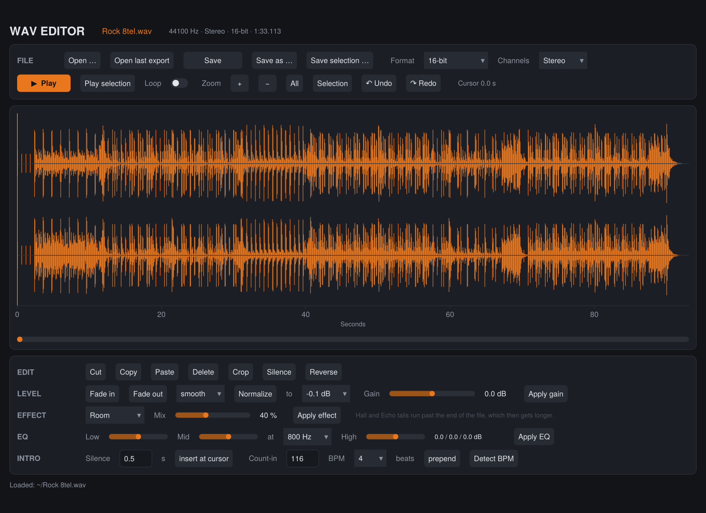

# WAV editor

The WAV editor (button *WAV-Editor* in the header) edits WAV files, for example a groove you just
exported, before it goes to the drum module. It opens in its own window. If a WAV was exported in
the current session, it is loaded right away.

It is based on SEdit, a separate GTK editor, rebuilt with the drum machine's interface and audio
engine. CD ripping, downloads and ffmpeg conversion from SEdit are not included.

## Opening and saving

- *Öffnen …* (open) loads any WAV: PCM 8/16/24/32 bit or 32-bit float, mono or stereo, any sample rate.
- *Letzten Export öffnen* loads the last WAV exported by the drum machine in this session.
- *Speichern* (save) overwrites the open file, *Speichern unter …* (save as) asks for a new name.
- *Auswahl speichern …* saves only the selection, for example a single bar as a sample.
- *Format*: 16 bit, 24 bit, 32-bit float or **AAC (.m4a)**. AAC is for sending examples (for
  example via WhatsApp): *Speichern* then writes an .m4a next to the WAV and leaves the WAV and the
  edit state unchanged. It needs the program `ffmpeg`.
- WAV formats: 16 bit, 24 bit or 32-bit float. 16- and 24-bit files keep their format, 8-bit files
  are saved as 16 bit and 32/64-bit files as 32-bit float. 16/24 bit are clipped to full scale on
  saving.
- Files with more than two channels: the first two (front left/right) are edited.
- *Kanäle* (channels): mono (average of both channels) or stereo (mono duplicated).

Saved files contain only the `fmt` and `data` chunks. The Roland TD-27 rejects WAVs with extra
metadata; it also shows only 16 characters of a file name, which is why saving warns about long
names.

A dot after the file name marks unsaved changes. *Öffnen …* and *Letzten Export öffnen* then
need a second click before the edits are discarded. Closing the window does not ask, so save first.

## Waveform and selection

| Action | Effect |
|---|---|
| click | sets the cursor (start of playback and insert position; *End* puts it after the last sample to append) |
| drag | selects a range |
| Shift + click | extends the selection to the click |
| mouse wheel | zooms in/out around the mouse |
| slider below the waveform | scrolls when zoomed in |
| *+* / *−* / *Alles* / *Auswahl* | zoom in, zoom out, whole file, fit the selection |

Stereo files show left (top) and right (bottom). During playback a blue line follows the position,
and the view pages along.

## Playback

- *Play* plays from the cursor to the end, or the selection if there is one. Pressing it again stops.
- *Auswahl spielen* plays the selection.
- *Loop* repeats the played range.

Playback uses the drum machine's audio output but bypasses the master effect and limiter, so the
file is heard exactly as it will be saved.

## Editing

Edits apply to the selection. Without a selection, level and effect edits apply to the whole file;
*Ausschneiden*, *Löschen*, *Zuschneiden* and *Stille* need a selection.

| Button | Effect |
|---|---|
| Ausschneiden / Kopieren / Einfügen | cut / copy / paste. Paste inserts at the cursor, or before the selection if there is one, and selects the pasted audio. Audio copied from a file with another sample rate is converted |
| Löschen | removes the selection (not the whole file) |
| Zuschneiden | keeps only the selection (trim) |
| Stille | silences the selection |
| Umkehren | reverses |
| Fade in / Fade out | fades, curve *linear* or *weich* (equal power, smoother on drums) |
| Normalisieren | scales the peak to 0, -0.1, -1, -3 or -6 dBFS |
| Gain anwenden | changes the level by the slider value (-24 … +24 dB) |
| Effekt anwenden | Room, Hall, Echo, Chorus, Flanger or Drive, amount by *Mix* |
| EQ anwenden | 3-band EQ: low shelf 120 Hz, mid bell 250 Hz – 3.2 kHz, high shelf 5 kHz, ±12 dB |
| am Cursor einfügen | inserts silence of the given length at the cursor |
| Einzähler voranstellen | puts 1–8 click beats at the given BPM before the audio (first click accented) |
| BPM erkennen | estimates the tempo of the selection (or file) and fills it into the BPM field |

All effects work at the file's own sample rate. Room, Hall and Echo ring on after the edited range. If the range reaches the end of the file, the
file gets longer by the decay. The echo time is one 8th note at the BPM in the intro row.

BPM detection works on the energy envelope and favours common practice tempos. On the example
songs it hits 16 of 18 test tempos within 3 %; very syncopated grooves (for example the Hip Workout
at 80 % and 120 % tempo) can come out at another, related tempo, so check the value. If no tempo
between 55 and 220 BPM is found, the field is left unchanged.

## Undo

Every edit can be undone (*Rückgängig*, up to 30 steps and 1 GB, so fewer steps for long files)
and redone (*Wiederholen*). An edit that fails leaves no undo step.

## Keyboard

| Key | Action |
|---|---|
| Space | play / stop |
| Ctrl+Z / Ctrl+Y | undo / redo |
| Ctrl+X / Ctrl+C / Ctrl+V | cut / copy / paste |
| Delete | delete selection |
| Ctrl+A | select all |
| Esc | clear selection |
| Home / End | cursor to start / end |
| Ctrl+S | save |
